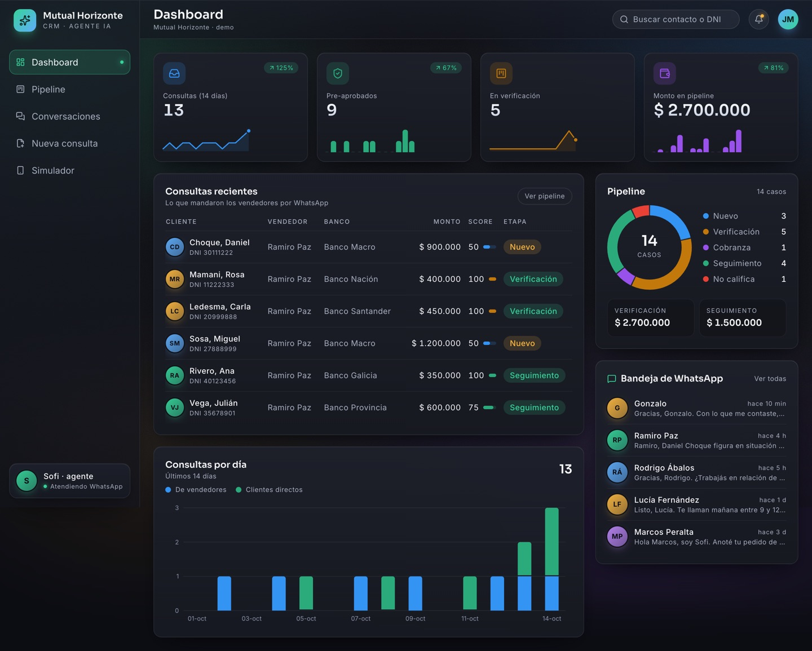
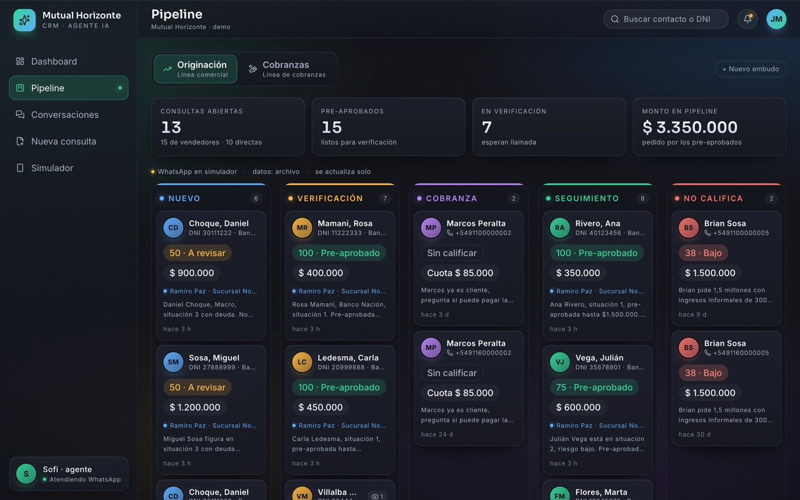
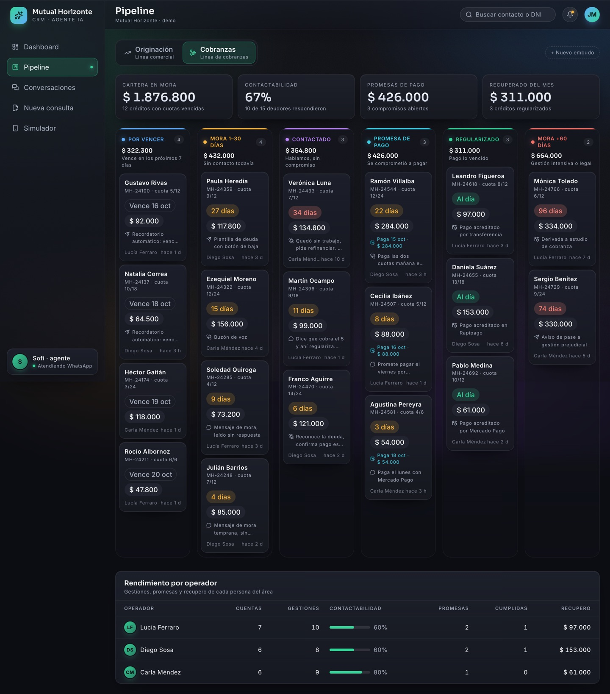
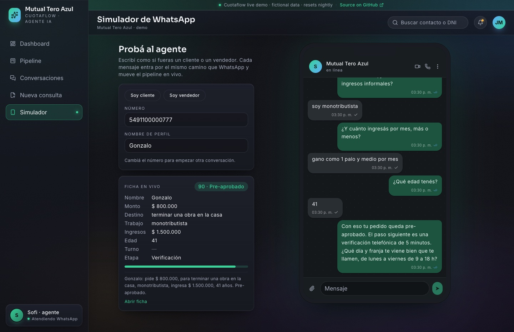
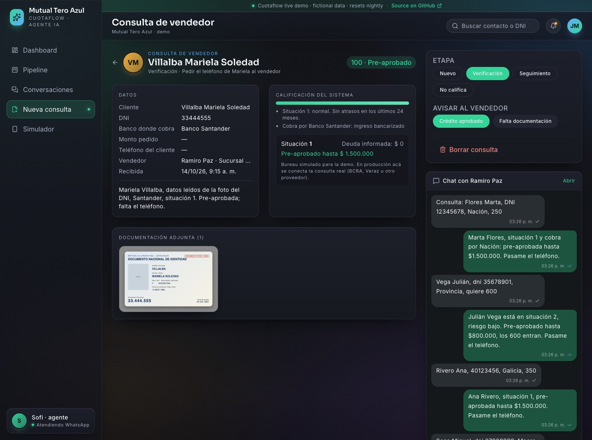
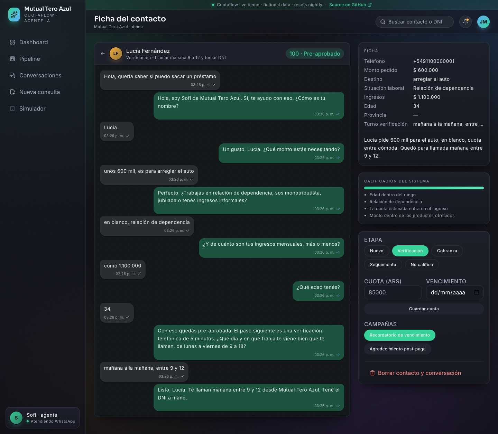
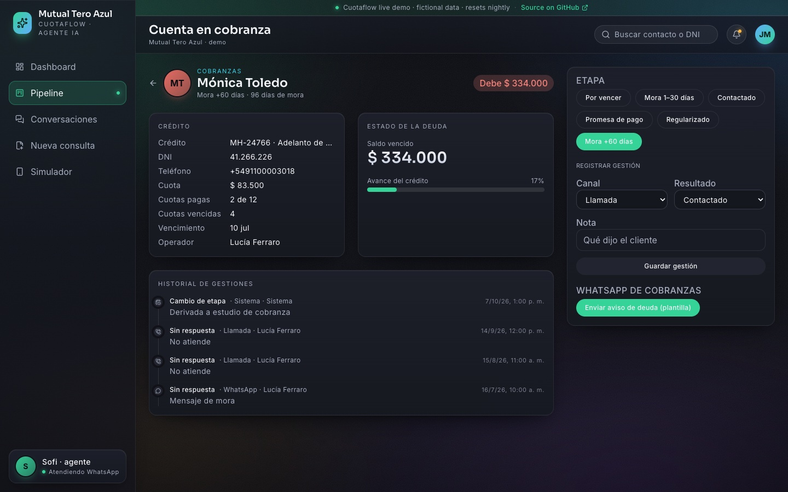
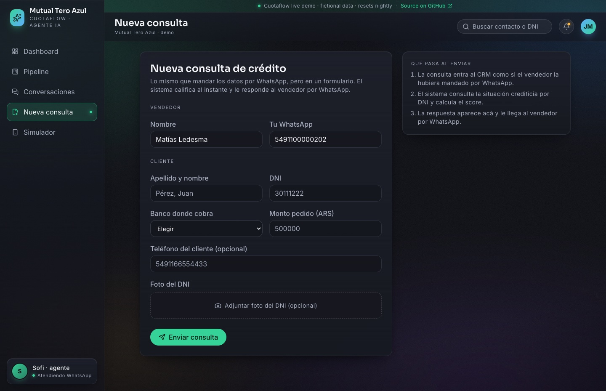

# Cuotaflow

**Cuotaflow — AI credit agent on WhatsApp.** It qualifies loan applicants and runs
collections, with its own CRM for the operators.

[](https://cuotaflow.vercel.app)
[](https://codespaces.new/MatheoTe/cuotaflow)

[](https://github.com/MatheoTe/cuotaflow/actions/workflows/ci.yml)

Cuotaflow is a WhatsApp AI agent with its own CRM for a consumer-lending business. Leads and
field sellers write to one WhatsApp line; Claude holds the conversation and
extracts structured data (including reading a photo of an ID card), while
deterministic code scores the applicant, queries a (simulated) credit bureau
and moves each case through an origination pipeline. Existing borrowers are
routed to a separate collections funnel with operator performance metrics.
Operators work from a Next.js dashboard backed by Supabase. The design rule
throughout: **the model talks and extracts, the code decides.**

> **Nota:** la interfaz del producto y las conversaciones del agente están en
> español rioplatense: el mercado objetivo es Argentina. El negocio
> ("Mutual Tero Azul"), las personas, los teléfonos y los DNI de la demo son
> ficticios.

Built with Next.js 16 (App Router, React 19), TypeScript (strict), Supabase
(Postgres), the Anthropic SDK (Claude Opus 5.5, structured outputs + vision),
the WhatsApp Cloud API, Tailwind and zod. Tested with Vitest, evaluated with an
offline/live golden set, checked in CI.

## Live demo

**[cuotaflow.vercel.app](https://cuotaflow.vercel.app)**, or
run the same thing in your browser with
[GitHub Codespaces](https://codespaces.new/MatheoTe/cuotaflow)
(no secrets needed). Both run in **demo mode** (`DEMO_MODE=1`):

- **No keys, no spend.** The agent answers with an offline, deterministic model
  that plugs into the same `Modelo` boundary the evals use
  (`src/lib/agent/modelo-demo.ts`). Claude is never called, even if a key is
  set; everything around the model (merge, guardrails, scoring, simulated
  bureau, pipeline) is the production code. It handles the demo script in
  `docs/mensajes-demo.txt` (including "reading" the fictional ID card in
  `public/demo/dni-ficticio.png`) and asks again when it does not understand.
  To see the real model, run locally with an `ANTHROPIC_API_KEY`.
- **Fictional data in memory.** The store is seeded at startup with the same
  fictional seed as `npm run seed` (leads, a seller with scored requests, one
  read from the ID photo, and the collections portfolio). It resets on every
  cold start and nightly through a Vercel cron that calls the token-protected
  `/api/demo/reset`.
- **WhatsApp off.** The webhook returns 404 and nothing is ever sent to Meta.
- **Abuse guard.** The simulator has a per-IP rate limit and a message length cap.

Try `/simulador`: "Soy vendedor" and paste
`Hola Sofi, te paso una consulta. Cliente Gutierrez Pablo, DNI 40123456, quiere 500 mil`,
or "Soy cliente" and start with `hola, necesito plata`.

## Screenshots

Fictional seed data (`npm run seed && npm run seed:cobranzas`); the UI is in Spanish.



<table>
  <tr>
    <td width="50%"><br><sub><b>Origination board.</b> New, verification, collections, follow-up and rejected, each case with its score.</sub></td>
    <td width="50%"><br><sub><b>Collections funnel.</b> Delinquency stages and the per-operator performance table.</sub></td>
  </tr>
  <tr>
    <td width="50%"><br><sub><b>Simulator.</b> A live conversation with the agent; the lead card fills in and gets scored as it goes.</sub></td>
    <td width="50%"><br><sub><b>Seller request.</b> Data read from the ID photo, bureau result, score reasons and the seller thread.</sub></td>
  </tr>
  <tr>
    <td width="50%"><br><sub><b>Lead record.</b> Full thread, extracted fields, system score with reasons and campaign buttons.</sub></td>
    <td width="50%"><br><sub><b>Debtor record.</b> Debt status, collection history and the WhatsApp debt notice.</sub></td>
  </tr>
  <tr>
    <td width="50%"><br><sub><b>Web form.</b> The same engine fed from a form instead of WhatsApp.</sub></td>
    <td width="50%"></td>
  </tr>
</table>

## Architecture

```mermaid
flowchart LR
  WA["WhatsApp user<br/>(lead or seller)"] -- "Cloud API webhook" --> HOOK["POST /api/whatsapp/webhook<br/>HMAC signature · zod · dedupe<br/>200 now, work in after()"]
  SIM["Simulator /simulador"] --> CHAT["POST /api/chat"]
  FORM["Web form /consulta"] --> CONS["POST /api/consulta"]

  HOOK --> PIPE
  CHAT --> PIPE
  CONS --> PIPE

  subgraph Core["procesarEntrante: single pipeline"]
    PIPE["Store message + photo"] --> AGENT["Agent: Claude Opus 5.5<br/>structured output (zod schema)<br/>vision for ID photos"]
    AGENT --> GUARD["Deterministic guardrails"]
    GUARD --> DECIDE{"Lead or seller?"}
    DECIDE -- "lead" --> SCORE["scoring.ts<br/>age · income type · installment/income"]
    DECIDE -- "seller, request complete" --> BUREAU["Credit bureau<br/>(simulated, deterministic)"]
    BUREAU --> SCOREQ["Request score"] --> AGENT2["Agent phrases the verdict"]
  end

  SCORE --> DB[("Supabase Postgres<br/>contacts · messages · media<br/>consultas · cobranzas")]
  AGENT2 --> DB
  DB --> CRM["CRM dashboard<br/>Next.js server components"]
  CRM -- "server actions: stage changes,<br/>reminders, seller notices" --> WAOUT["WhatsApp Cloud API"]
  PIPE -- "reply" --> WAOUT
```



One turn, end to end: the webhook verifies the signature, validates the payload,
acknowledges Meta immediately and continues in `after()`. The pipeline stores
the message, builds the thread (only the last 4 photos travel as images) and
asks Claude for a schema-validated object: the WhatsApp reply, the role
(lead or seller), the accumulated fields, the stage and a one-line summary for
the operator. Guardrails correct the stage when it breaks a business rule, the
code computes the score, and when a seller's request becomes complete the
bureau runs **once** and the agent is called a second time with the verdict
already decided, only to phrase it.

## Key engineering decisions

**The LLM extracts, code decides.** Eligibility, scores, the bureau lookup and
the suggested amount are plain TypeScript (`src/lib/scoring.ts`). The model
never invents a verdict: for sellers it receives the result in a system note
and only writes the message. Business rules change without touching the
prompt, they are unit-tested, and an operator can see the exact reasons behind
a score.

**Structured output instead of a tool loop.** Each turn is one
`messages.parse()` call with a zod schema (`output_config.format`). Every turn
needs the same things (reply, extracted fields, stage), so a fixed schema is
cheaper, faster and easier to validate than letting the model pick tools; side
effects (bureau, DB writes) stay in the pipeline where they are idempotent and
testable. Trade-off: a new capability means extending the schema rather than
registering a tool.

**Guardrails in code over the model output** (`src/lib/agent/guardas.ts`).
The prompt says "no verdict before all the data is in" and "existing borrowers
go to collections"; `aplicarGuardas` enforces both and logs every correction.
A null field from the model means "unchanged", never "erase"
(`fusionarSalida`), so a model slip cannot wipe data the lead already gave.

**Prompt caching by construction.** The system prompt is static (built from
`src/lib/negocio.ts`, no dates or per-contact data) and marked with
`cache_control`; volatile state (time, accumulated data, score) goes at the end
of the last user turn, so the whole prefix is reusable across turns.

**One pipeline, three entry points.** WhatsApp, the simulator and the web form
all call `procesarEntrante`, so the demo exercises exactly the production path.
The pipeline receives its store, model and bureau as injected dependencies.

**Webhook hardening.** `X-Hub-Signature-256` verified with HMAC-SHA256 in
constant time (`WHATSAPP_APP_SECRET`); payloads validated with zod (malformed
ones are dropped with a 200 so Meta stops retrying); duplicate deliveries are
stopped in-process (in-flight set) and in the database (unique `wa_id`).

**Storage behind an interface.** `Store` has a Supabase implementation, a JSON
file implementation for zero-config local runs, and an in-memory one for tests
and evals.

**Evals, not vibes.** A golden set of fictional conversations is graded on the
final CRM state (qualifies / does not qualify / asks for missing data / hands
off to a human) plus a deterministic rubric on every outgoing message (at most
one question, no lists, no emojis, never "approved" without "pre-", never ask
an end client for bank credentials). Offline mode replays recorded model
outputs through the real pipeline; live mode runs the same conversations
against Claude.

### Known trade-offs (it is a demo)

- `after()` is not a durable queue: if the function dies mid-turn, that message
  is not retried. Production would put a queue between the webhook and the agent.
- The CRM has no authentication and the server uses the Supabase service role
  key. Fine for a sales demo, not for real customer data.
- Photos are stored as base64 rows; production would use object storage with
  signed URLs.
- The credit bureau is simulated (a deterministic hash of the DNI) so the demo
  is repeatable.

## Run locally

Requirements: Node 20.9+ (CI uses 22) and an Anthropic API key.

```bash
cp .env.example .env.local      # set ANTHROPIC_API_KEY; everything else is optional
npm install
npm run seed                    # fictional leads, a seller and scored requests
npm run seed:cobranzas          # fictional collections portfolio
npm run dev                     # http://localhost:3000
```

No API key? `DEMO_MODE=1 npm run dev` runs the demo mode described above.

Without Supabase, data lives in `data/store.json`. Open `/simulador` to chat
with the agent as a lead or as a seller (a fictional ID card to attach is at
`public/demo/dni-ficticio.png`).

### Supabase and WhatsApp (optional)

1. **Supabase:** create a project and run `supabase/schema.sql` in the SQL
   editor (or `supabase db push` with `supabase/migrations`). Set
   `SUPABASE_URL` and `SUPABASE_SERVICE_ROLE_KEY`. `scripts/setup-supabase.sh`
   automates project creation, migrations, Vercel env vars, seed and deploy.
2. **Meta:** create a Business app with the WhatsApp product. From *API Setup*
   take the test number's `WHATSAPP_PHONE_NUMBER_ID` and a token
   (`WHATSAPP_TOKEN`); from *Settings → Basic*, the `WHATSAPP_APP_SECRET`.
3. **Webhook:** point it to `https://<your-deploy>/api/whatsapp/webhook`, use
   your `WHATSAPP_VERIFY_TOKEN` and subscribe to `messages`.

The Meta test number can only message up to 5 registered recipients, and
outside the 24-hour customer window only approved templates can be sent.

## Tests and evals

```bash
npm test                 # Vitest: 172 tests, no network
npm run test:coverage    # coverage report for src/lib
npm run evals            # golden set, offline (recorded model outputs)
npm run evals:live       # same conversations against Claude (reads .env.local, spends tokens)
npm run evals -- --only vendedor-califica
npm run typecheck && npm run lint && npm run build
```

The unit tests cover thread building and cache layout, merge semantics, the
refusal fallback and SDK parameters (`tests/agent.test.ts`); the guardrails;
scoring thresholds and the simulated bureau; the prompt state; the full
pipeline for leads and sellers on an in-memory store (score once, a new request
on a new DNI, duplicate message ids); the webhook route (handshake, signature,
schema rejection, retries, per-message error isolation); WhatsApp payload
parsing and the Argentine number-format fallback; and collections metrics.

## Project structure

```
src/
  app/
    api/whatsapp/webhook/   Meta webhook: GET handshake, POST messages
    api/chat/               simulator endpoint (same pipeline, no Meta)
    api/consulta/           web-form endpoint (same pipeline)
    api/media/[id]/         serves stored photos
    actions.ts              server actions: stage changes, reminders, seller notices
    page.tsx, tablero/, conversaciones/, contactos/, consultas/, cobranzas/, simulador/, consulta/
  components/               dashboard UI (charts, kanban, chat thread, shadcn/ui primitives)
  lib/
    agent/agent.ts          model boundary, thread building, merge, responder
    agent/guardas.ts        deterministic guardrails over the model output
    agent/prompt.ts         static system prompt + volatile state message
    pipeline.ts             procesarEntrante: the single path for every inbound message
    scoring.ts              lead score, seller-request score, simulated bureau
    negocio.ts              business config: products, rules, sellers, templates
    whatsapp.ts             Cloud API client, webhook schema, signature check
    db.ts                   Store interface: Supabase, JSON file, in-memory
    cobranzas*.ts           collections funnel and operator metrics
evals/                      golden set, rubric, runner (offline/live)
tests/                      Vitest suite
supabase/                   schema and migrations
scripts/                    seeds and Supabase/Vercel setup
docs/                       demo script and sample messages (Spanish)
```

## Roadmap

- Durable queue between the webhook and the agent (retries, back-pressure).
- Operator authentication (Supabase Auth) and row-level security; take the
  service role key out of the request path.
- Real bureau integration (BCRA or a commercial provider) behind the same function.
- Record mode for evals (`--live --record`) to refresh offline fixtures from
  real model runs, plus an LLM-as-judge pass for tone.
- Approved WhatsApp templates for reminders outside the 24-hour window.
- Object storage for photos; multi-line and multi-tenant configuration.

## Author

Built by **Matheo Telesca**, full stack and AI engineer ·
[LinkedIn](https://www.linkedin.com/in/matheo-telesca-084a20209/)
